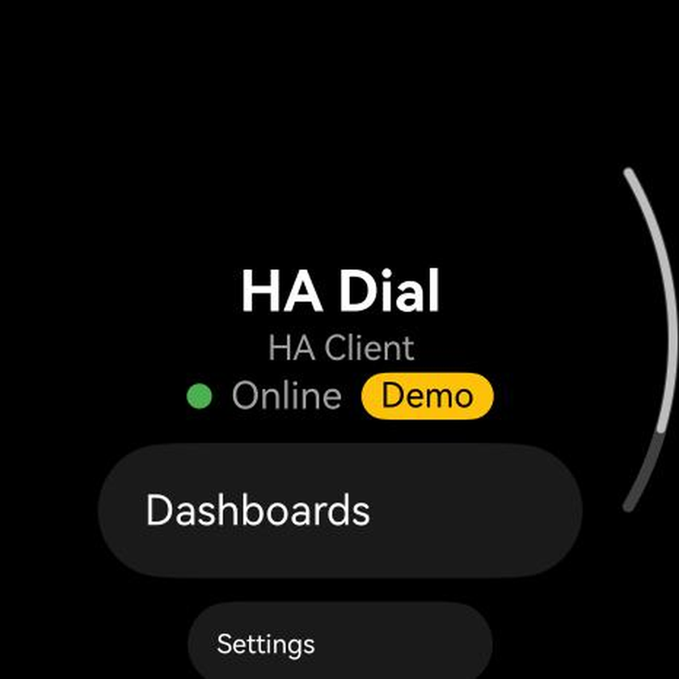
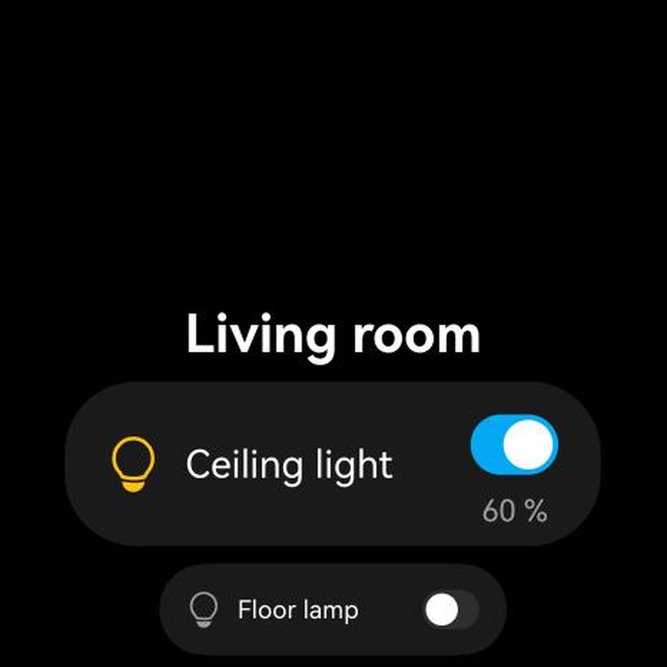
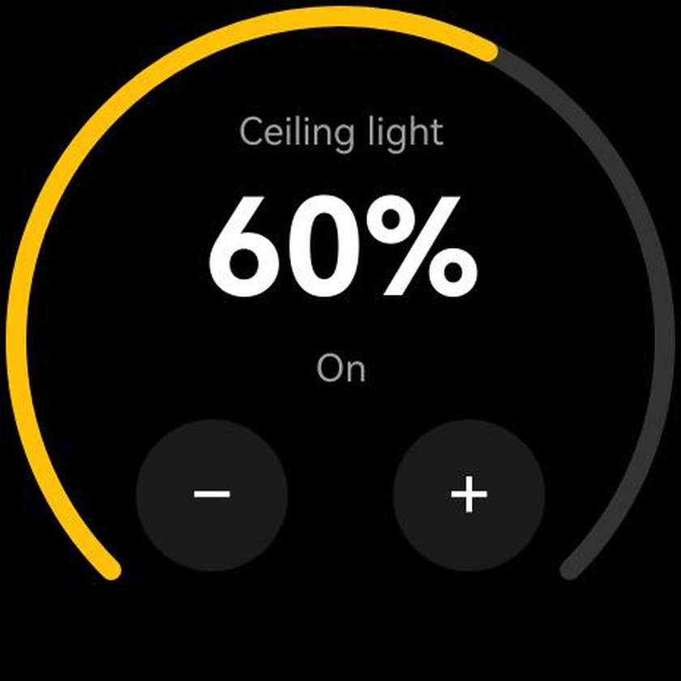
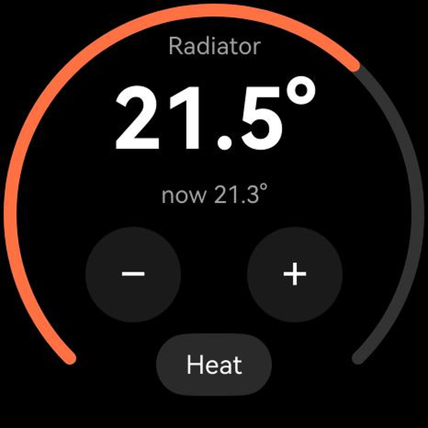

# HA Dial — Home Assistant on your Huawei watch

HA Dial is an unofficial [Home Assistant](https://www.home-assistant.io/) client for Huawei watches running HarmonyOS.
It is available for free in Huawei AppGallery.

This repository is the place for **feature requests, bug reports and compatibility reports**. The app's source code is not published here.

## Install

There is no web link to watch apps in AppGallery. Install it from the watch store:

1. Open the **Huawei Health** app on your phone.
2. **Devices** → your watch → **AppGallery**.
3. Search for **HA Dial** and install.

On the watch itself: open **AppGallery** and search for **HA Dial**.

## What it does (v1.0.0)

- Sign in with your Home Assistant username and password; two-factor authentication (TOTP) is supported.
- Finds Home Assistant in your home network automatically (mDNS); manual address as a fallback.
- Your dashboards, plus an automatic overview by rooms (areas).
- Switches, lights with brightness, fans, thermostats and radiator valves, number helpers — with the crown or on-screen −/+ buttons.
- Sensors and binary sensors: temperature, humidity, illuminance, doors, windows, motion, battery and more.
- Live state updates; start screen of your choice; adjustable crown sensitivity and step.
- English, German and Russian.

## Try it without a server (demo mode)

Settings → address `0.0.0.0` → username `demo`, password `demo`. Everything runs offline on the watch.

## Requirements and network

- A Huawei watch with HarmonyOS 5 or newer (full wearable OS). Tested on **Huawei Watch 5**.
  The **Watch GT / Fit** series (lite OS) are **not** supported.
- Home Assistant 2024.4 or newer and a Home Assistant user account.
- At home, the watch must be on **Wi-Fi**. Over the phone's Bluetooth connection the watch reaches the internet, but not devices in your home network (verified with an iPhone).
  Away from home you need an external address (Home Assistant Cloud, your own domain, or a VPN).

## Feedback

- 💡 [Request a feature](../../issues/new?template=feature_request.yml)
- 🐞 [Report a bug](../../issues/new?template=bug_report.yml)
- ⌚ [Works on my watch](../../issues/new?template=works_on_my_watch.yml) — helps build the compatibility list
- 💬 [Discussions](../../discussions) — ideas and voting (add a 👍 to the ideas you want first)

Russian and German are welcome too. / Можно писать по-русски. / Gerne auch auf Deutsch.

## Compatibility

| Watch | HarmonyOS | Status |
|---|---|---|
| Huawei Watch 5 | 6.1 | ✅ tested by the developer |

## Privacy

HA Dial talks only to your own Home Assistant server. No analytics, no ads, no third-party services.
[Privacy policy](https://efimomax.de/hadial/privacy)

---

Home Assistant is a trademark of the Open Home Foundation. HA Dial is not affiliated with or endorsed by Home Assistant.
